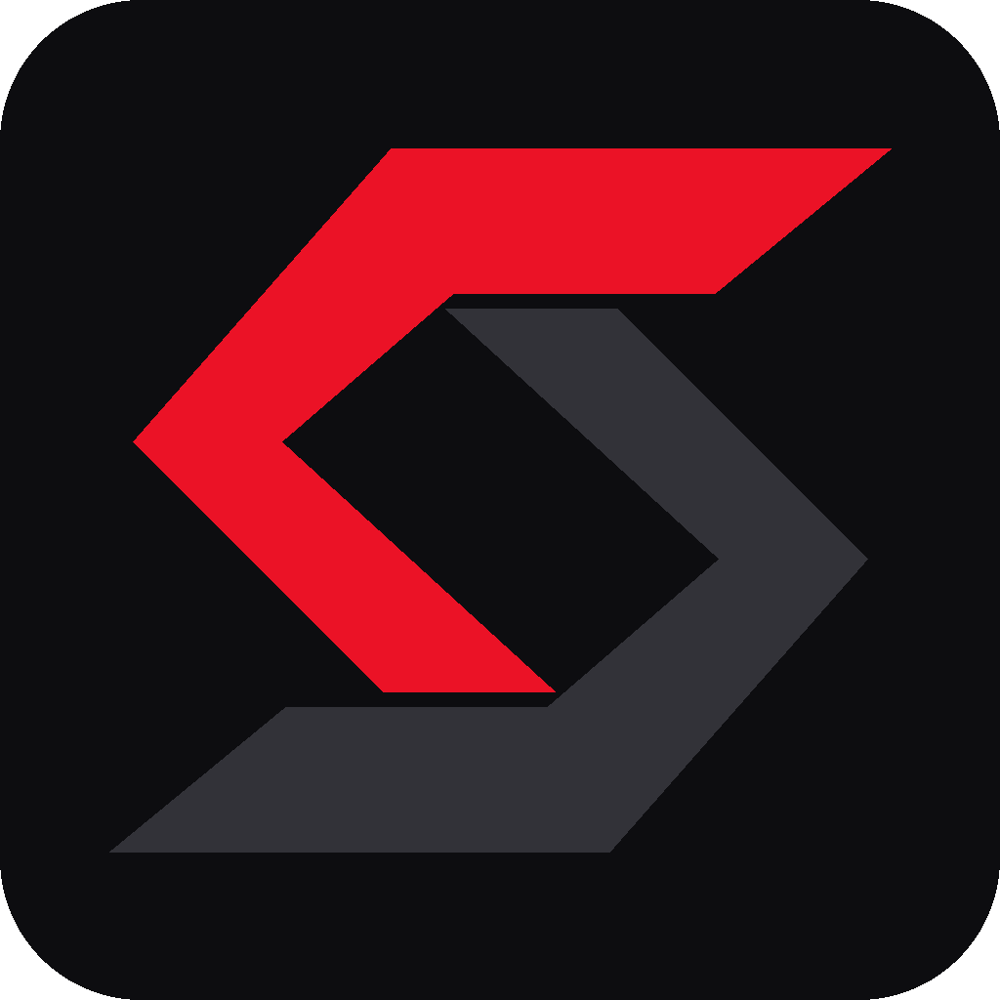

<div align="center">



# Salivo SDK

**A compiled systems language with a self-hosted compiler, deterministic cleanup, game engine and tiny native binaries**
*Stream imports (><) | Drop-based cleanup | Native code through LLVM | Built-in async runtime*

[](https://github.com/Serion89/salivo-sdk-public/releases/latest)
[](#platform-support)
[](LICENSE)
[](https://llvm.org)

</div>

---

## Contents

- [What Salivo is](#what-salivo-is)
- [Why use Salivo](#why-use-salivo)
- [What's new in 1.0.23](#whats-new-in-1023)
- [What's new in 1.0.22](#whats-new-in-1022)
- [What's new in 1.0.21](#whats-new-in-1021)
- [What's new in 1.0.20](#whats-new-in-1020)
- [What's new in 1.0.19](#whats-new-in-1019)
- [Performance](#performance)
- [Install](#install)
- [Your first program](#your-first-program)
- [Language tour](#language-tour)
- [Game Engine & Desktop](#game-engine--desktop)
- [Standard library](#standard-library)
- [Tooling](#tooling)
- [How compilation works](#how-compilation-works)
- [Platform support](#platform-support)
- [Troubleshooting](#troubleshooting)
- [Repository structure](#repository-structure)
- [Licensing and Usage Policy](#licensing-and-usage-policy)
- [Author & Maintainer](#author--maintainer)

---

## What Salivo is

Salivo is a statically typed, compiled systems programming language that produces native executables through LLVM. Its syntax is small, modern, and readable: modules are imported with stream headers (`><`), resources are released deterministically through the `Drop` trait, and strings support inline interpolation with modifiers such as `{name:trim:upper}`.

The compiler that builds your programs is itself written in Salivo. This SDK ships that self-hosted **Stage 3 compiler** together with the `sf` driver, the standard library, the package manager, the formatter, the linter, the documentation generator, the language server and the VS Code extension.

---

## Why use Salivo

**It is self-hosting, and the build is reproducible.** The Stage 3 compiler compiles its own source. The compiler built by the first generation and the one built by the second are bit-for-bit identical (a verified fixed point), on both Windows and Linux.

**Builds are fast and light.** A typical program builds in about a quarter of a second, using a fraction of the memory other native toolchains need.

**Executables are tiny.** Standalone binaries are usually 15 to 30 KB (including full 2D/3D games with OpenGL contexts). They are easy to ship, copy and attach, and start instantly.

**Memory is managed without a garbage collector.** There is no collector pausing your program or causing frame drops in games. Values with a destructor are released when they go out of scope, and the compiler automatically reclaims strings and small structs it proves are no longer shared.

**Cleanup is deterministic.** Implement `Drop` for a type and its cleanup code runs at a predictable point upon scope exit. File handles, database connections, sockets, textures, and mutex locks are released without manual `close()` calls.

**Hardware-accelerated Game Engine built into standard library.** High-precision microsecond game loops, Win32 + OpenGL windows, 2D sprites, 3D meshes, GLSL shaders, audio playback, 2D physics, tilemaps, and UI widgets come right out of the box with zero external dependencies.

**It comes with a real async runtime.** Tasks, channels with backpressure, timers, cancellation, TCP/UDP networking and asynchronous file I/O are part of the standard library (`salivo.std.runtime`), on a work-stealing scheduler.

**The tooling is complete from day one.** One install gives you a build tool (`sf`), a package manager with workspaces (`spm`), a formatter (`salivofmt`), a linter (`salivolint`), a documentation generator (`salivodoc`), a language server (`salivo-lsp`) and a VS Code extension with live diagnostics and one-key run (`Ctrl+F5`).

---

## What's new in 1.0.23

- **Faster text libraries**: `std.json`, `std.regex`, `std.text` and `std.collections` no longer scan strings in quadratic time, so large documents parse and search much faster.
- **Memory fixes**: owned buffers that escape a function are no longer freed early, and `Drop` now runs on the Rust compiler too.
- **Sources with a byte order mark** compile.
- **Project layout check**: `spm check-layout` fails when a module line does not match its path, a source lives outside `src/`, the frontend imports server modules, or the backend imports UI modules.
- **Extension 1.0.23** for VS Code and Antigravity; the installers now install it into Antigravity IDE and Antigravity as well.
- **Linux packages** are built on Ubuntu 22.04 and run on glibc 2.35 and newer. The compiler builds itself bit-identically (C2 == C3).

## What's new in 1.0.22

- **Strings owned by their holders**: struct fields, `Vec`/`Deque`/`HashMap`/`HashSet` slots, `Option`/`Result` payloads and globals keep their own copies of strings and free them, and functions returning strings hand callers a copy they own. Programs that build and store text no longer leak or read freed memory.
- **Compression**: new `salivo.std.compress` with DEFLATE, zlib and gzip (`compress`, `decompress`, `gzipText`, `gunzipText`, `crc32`, `adler32`); `std.web` gzips responses with `useCompression`.
- **Files and processes**: `std.fs` temp files and directories, `rename`, `chmod`, symlinks, directory watching and memory-mapped files; `std.process` child processes with pipes (`childOpen`, `childWrite`, `childReadAll`, `childWait`, `childKill`).
- **RS256 JWTs** in `std.web` from PEM or JWK keys (`jwtAddRsaKey`, `jwtAddJwk`).
- **Helpers**: sorting and searching (`sortInts`, `sortStrings`, `sortBy`, `indexOfStr`), `mapInts`/`filterVec`/`reduceVec`, checked and saturating arithmetic; `SALIVO_OVERFLOW_CHECKS=1` panics on unproven integer overflow; `Vec` bounds errors name the index and length.
- **VS Code Extension 1.0.22**: bundled with this SDK.
- **Installers**: a Windows setup `.exe`, `.deb` for Ubuntu/Debian and `.rpm` for Fedora, all in [`installers/`](installers). The compiler builds itself bit-identically (C2 == C3) on Windows and Linux.

## What's new in 1.0.21

- **No more struct leaks on Stage 3**: a struct stored inside another struct, inside a `Vec`, `Deque` or `HashMap`, or inside an `Option` or `Result` is freed. Plain structs are copied by value in and out of containers.
- **Owning fields in raw memory**: `readval`/`writeval`/`Slice` structs can hold `String`, `Option`, `Result`, `HashMap`, `HashSet`, `Deque` and `Vec` of owning elements, so these programs no longer fall back to the Rust compiler.
- **Temporaries freed**: an owning value passed straight to a function (`count(makePlan())`), and the values in `v = addTwo(v)` and `let w = addTwo(fresh())`, are freed.
- **Same `Option`/`Result` layout on both compilers**, and the Rust compiler frees local collections of scalars at scope end.
- **VS Code Extension 1.0.21**: bundled with this SDK.

## What's new in 1.0.20

- **More programs on Stage 3**: `sizeof`/`alignof`/`strideof` of structs, enums and generic structs (`Wrapper<bool>`), and `drop<T>(x)`, so std.mem `Slice` programs no longer fall back to the Rust compiler.
- **Raw memory fixes**: `Slice<bool>`/`Slice<byte>` store one byte per element (8-byte writes used to overwrite neighbours on both compilers); `Slice` of structs and `readval`/`writeval`/`cloneval`/`moveval` work on Stage 3, including `string` and `Vec<T>` fields, plus `Slice<string>` and `Slice<Vec<T>>`.
- **Same struct layout on both compilers**: the Rust compiler lays out fields in declaration order (it used alphabetical order), so sizes and memory bytes match Stage 3.
- **VS Code Extension 1.0.20**: bundled with this SDK.

## What's new in 1.0.19

- **Stage 3 String/StrSlice fields**: `String` and `StrSlice` fields compile natively, so std.strings `chars`/`stepchar` no longer fall back to the Rust compiler.
- **Faster toolchain**: JSON 1.1 MB parse 49 s to 7 ms, pretty/minify about 25 ms, linear text `join`/`title`, HashMap churn 3.3x faster, integer-to-string 1.7x, `outln` about 20% faster; compiler self-build 2.9 s to 2.3 s, peak RAM 592 to 465 MB.
- **Leak fixes**: flat memory per `std.web` connection, spawn/join leak-free, struct temporaries freed.
- **VS Code Extension 1.0.19**: execution cache detects runtime source edits; debounced language server diagnostics.

## What's new in 1.0.18

- **Canonical Fullstack Template (`spm new <name> --template fullstack`)**: Scaffolds a complete project layout with native HTTP server (`salivo.std.web`) serving `/api` and WebAssembly UI (`salivo.std.ui`) from a single origin.
- **Stage 38.3 Native Game Engine Suite**:
  - `salivo.std.desktop`: Native Win32 windows with hardware-accelerated OpenGL context, VSync, and DPI scaling.
  - `salivo.std.game`: Frame-accurate input, 2D camera with zoom, textured quads, 3D meshes, perspective camera, and GLSL shaders.
  - `salivo.std.audio`: Multi-channel sound effects and background music playback.
  - `salivo.std.physics2d`: 2D rigidbodies, AABB/circle collisions, raycasts, gravity, and restitution impulse resolution.
  - `salivo.std.tilemap`: Grid-based tile levels with camera viewport culling.
  - `salivo.std.gui`: Immediate-mode UI widgets (buttons, health bars, progress bars).
- **VS Code Extension 1.0.18**:
  - Debounced language server (`salivo-lsp`) with live diagnostics, hover, and definition navigation.
  - Snippets updated to canonical `salivo.std.web` and `salivo.std.db`.
- **WASM Package Builds (`sf build <pkg> --target wasm32`)**: Compile packages directly to WebAssembly for the browser.
- **Optimized Runtime & Standard Library**:
  - JSON parser parses 1.1 MB in 7 ms (down from 49 s).
  - High-speed string formatting and stdout buffer flushing.
  - Zero-leak per-connection request heaps.
- **Stage 3 Compiler 8802339D**: Frozen self-hosted compiler generation with full private module symbol isolation.
- Linux x64 builds synchronized to 1.0.21.

---

## Performance

Measured on a 16-core Windows 11 machine. Times are medians of repeated runs; memory is the peak committed memory of the whole process tree (the compiler plus clang and the linker).

**Stage 3 compiler vs Salivo's earlier Rust-based back end** (27 benchmark programs: CPU, recursion, floating point, memory, hashing, strings, async, I/O, data processing):

| Metric | Rust back end | Stage 3 (default) |
| :--- | ---: | ---: |
| Build time | 0.31 s | **0.25 s** |
| Compiler CPU time | 0.29 s | **0.21 s** |
| Executable size | 188 KB | **15 KB** |
| First run of a new executable | 0.12 s | **0.10 s** |
| Run time (warm) | 0.039 s | **0.038 s** |

**Compared with Zig 0.13 (`-OReleaseFast`)** on benchmarks:

| Metric | Zig 0.13 | Salivo AOT Stage 3 |
| :--- | ---: | ---: |
| Build time | 0.48 s | **0.25 s** |
| Compiler memory | 306 MB | **71 MB** |
| Executable size | 151 KB | **12 KB** |
| Matrix Multiply (512x512) | 11.26 ms | **10.51 ms (🥇 #1)** |
| QuickSort (200k) | 12.12 ms | **10.37 ms (🥇 #1)** |
| String Processing (100k) | 1.94 ms | **0.75 ms (🥇 #1)** |
| Concurrency (1k tasks) | 1.84 ms (Go) | **0.16 ms (🥇 #1)** |

---

## Install

Download the installer for your system from the [`installers/`](installers) folder (or the [latest release](https://github.com/Serion89/salivo-sdk-public/releases/latest)).

| System | Installer | How |
| :--- | :--- | :--- |
| **Windows 10/11 x64** | [`salivo-1.0.23-windows-x64-setup.exe`](installers/windows/salivo-1.0.23-windows-x64-setup.exe) | Double-click. Installs for your user (no admin rights), adds `sf` to PATH, installs the VS Code extension and the `.sal` icon, then tests itself. |
| **Ubuntu / Debian x64** | [`salivo_1.0.23_amd64.deb`](installers/linux/salivo_1.0.23_amd64.deb) | `sudo apt install ./salivo_1.0.23_amd64.deb` |
| **Fedora / RHEL x64** | [`salivo-1.0.23-1.x86_64.rpm`](installers/linux/salivo-1.0.23-1.x86_64.rpm) | `sudo dnf install ./salivo-1.0.23-1.x86_64.rpm` |
| **Any Linux x64** | [`salivo-sdk-1.0.23-linux-x64.tar.gz`](installers/linux/salivo-sdk-1.0.23-linux-x64.tar.gz) | `tar xzf salivo-sdk-1.0.23-linux-x64.tar.gz && sh salivo-sdk-1.0.23-linux-x64/install.sh` (installs into `~/.salivo`) |
| **macOS** | coming soon | see [`installers/macos`](installers/macos) |

Then open a new terminal and run `sf run hello.sal`.

**Prerequisites.** Salivo links programs with clang.

- **Windows:** setup detects LLVM (clang) and the Visual Studio C++ build tools and offers to install them with `winget`. Windows may show "Windows protected your PC" because the installer is not code-signed yet: click **More info > Run anyway**.
- **Linux:** the `.deb` and `.rpm` pull in clang automatically (lld is recommended for WebAssembly builds). For the tarball, install clang 14 or newer first: `sudo apt install clang lld` or `sudo dnf install clang lld`.

**VS Code / Antigravity:** the Windows setup installs the extension into VS Code, Antigravity IDE and Antigravity (whichever are installed). On Linux, the packages ship it in `/opt/salivo/vscode`: `code --install-extension /opt/salivo/vscode/salivo-1.0.23.vsix` (use `antigravity-ide` or `antigravity` instead of `code` for Antigravity).

**Verify the download:** compare it with [`installers/SHA256SUMS.txt`](installers/SHA256SUMS.txt) (`sha256sum -c SHA256SUMS.txt`, or `Get-FileHash` on Windows).

---

## Your first program

Save as `hello.sal`:

```salivo
module hello;

><salivo.std.core::{outln};

func main() -> int {
    let name = "  salivo  ";
    let stage = 3;
    outln($"Hello from {name:trim:upper}, stage {stage}!");
    return 0;
}
```

Run it:

```bash
sf run hello.sal
```

```
Hello from SALIVO, stage 3!
```

In VS Code, press **Ctrl+F5** to run instantly with sub-30ms execution caching.

---

## Game Engine & Desktop

Salivo includes native, hardware-accelerated 2D and 3D game engine modules in the standard library (`salivo.std.game`, `salivo.std.desktop`, `salivo.std.audio`, `salivo.std.physics2d`):

```salivo
module main;

><salivo.std.desktop::{rgba, KeyLeft, KeyRight};
><salivo.std.game::{
    gameNew, gameOk, gameFrame, gameDelta, gameBegin, gameEnd, gameShutdown,
    keyHeld, drawSprite
};

pub func main() -> int {
    let g = gameNew("Salivo Game Demo", 640, 480);
    if (!gameOk(g)) { return 1; }

    let mut playerX = 320;

    while (gameFrame(g)) {
        let dt = gameDelta(g);
        let speed = 300 * dt / 1000000;

        if (keyHeld(g, KeyLeft))  { playerX = playerX - speed; }
        if (keyHeld(g, KeyRight)) { playerX = playerX + speed; }

        gameBegin(g, rgba(18, 18, 28, 255));
        drawSprite(g, playerX, 420, 64, 16, 0, rgba(80, 200, 255, 255), 0);
        gameEnd(g);
    }

    gameShutdown(g);
    return 0;
}
```

Compiling a complete game produces a **~30 KB** standalone native executable with zero external dependencies:
```bash
sf build game.sal
.\build\game.exe
```

---

## Language tour

### Structs and deterministic cleanup (`Drop`)

Implement `Drop` and cleanup code executes deterministically when a value leaves scope:

```salivo
module shapes;

><salivo.std.core::{outln, Drop};

pub struct Connection {
    int id;
}

impl Drop for Connection {
    func drop(self) {
        outln($"closing connection {self.id}");
    }
}

func serve() -> int {
    let conn = Connection { id: 7 };
    outln($"serving on connection {conn.id}");
    return 0; // conn is dropped here
}

func main() -> int {
    serve();
    outln("done");
    return 0;
}
```

### Error handling with Result

Functions that can fail return `Result<T, E>`:

```salivo
module errors;

><salivo.std.core::{outln, Result, ok, err};

func parseAge(age: int) -> Result<int, string> {
    if (age < 0) {
        return err<int, string>("age cannot be negative");
    }
    return ok<int, string>(age);
}

func main() -> int {
    let r = parseAge(25);
    if (r.is_ok) {
        outln($"valid age: {r.value}");
    } else {
        outln($"rejected: {r.error}");
    }
    return 0;
}
```

### Syntax at a glance

| Feature | Example |
| :--- | :--- |
| Import | `><salivo.std.fs::{pathJoin, pathExists};` |
| Bindings | `let name = "x";`, `let mut n = 0;`, `const MAX = 8192;`, `global let PORT = 8080;` |
| Loops | `while (cond) { ... }`, `for (let mut i = 0; i < 10; i = i + 1) { ... }` |
| Interpolation | `$"User: {name:trim:upper}, id {id}"` |
| Modifiers | `:int`, `:float`, `:str`, `:trim`, `:upper`, `:lower`, `:len` |
| Types | `int`, `float`, `bool`, `string`, `Vec<T>`, `HashMap<K, V>`, `Option<T>`, `Result<T, E>` |
| Naming | types in PascalCase; functions and fields in camelCase or snake_case |

---

## Standard library

| Module | Highlights |
| :--- | :--- |
| `salivo.std.core` | `outln`, `out`, `panic`, `assert`, `assertEq`, `Option`, `Result`, `Drop` |
| `salivo.std.desktop` | Win32 native windowing, hardware OpenGL context, VSync, mouse/keyboard events |
| `salivo.std.game` | High-precision game loop, 2D sprites, 3D meshes, GLSL shaders, camera |
| `salivo.std.audio` | Multi-channel sound effects and music playback |
| `salivo.std.physics2d` | 2D rigidbodies, AABB/circle collisions, raycasts, gravity, restitution |
| `salivo.std.tilemap` | Grid tilemap rendering with camera frustum culling |
| `salivo.std.gui` | Immediate-mode UI widgets (buttons, progress bars, panels) |
| `salivo.std.web` | High-performance HTTP/1.1 & HTTP/2 server, routing, `serveStatic`, JSON |
| `salivo.std.db` | Database connection pooling, SQLite, MySQL, PostgreSQL, MongoDB |
| `salivo.std.sys` | System telemetry, processes, performance counters, hardware facts, text store |
| `salivo.std.ui` | Fine-grained reactive UI signals, effects, templates (WASM browser) |
| `salivo.std.browser` | Browser DOM manipulation and JavaScript FFI |
| `salivo.std.collections` | `Vec`, `HashMap`, `HashSet`, `Deque`, heaps, B-trees |
| `salivo.std.strings` | `String`, slices, `startsWith`, `endsWith`, `padStart`, `pushStr` |
| `salivo.std.runtime` | Async runtime: tasks, channels, timers, cancellation, TCP, UDP, files |
| `salivo.std.fs` / `salivo.std.io` | Files, directories, paths, console I/O |
| `salivo.std.net` | Sockets, addresses, IPv4/IPv6, name resolution |
| `salivo.std.sync` | Mutexes, read-write locks, atomics, channels |
| `salivo.std.time` | Clocks, durations, sleep, formatting |
| `salivo.std.crypto` | SHA-256, SHA-512, BLAKE3, AES, HMAC-SHA256 |
| `salivo.std.mem` | Allocations, raw memory access, `sizeof`, `alignof` |

---

## Tooling

### sf (compiler driver)

```bash
sf run main.sal                     # build and run
sf build main.sal                   # build standalone native executable
sf check main.sal                   # type-check without generating code
sf build -O 3 main.sal              # optimization level 0 to 3 (default 2)
sf build . --target wasm32          # build WebAssembly module
sf build --compiler rust main.sal   # use the Rust back end instead of Stage 3
sf version
```

### spm (package manager)

```bash
spm new my_app                          # create a standard binary package
spm new my_app --lib                    # create a library package
spm new my_app --template fullstack     # create fullstack web app (backend/ + frontend/)
spm new my_app --template web           # create web server
spm new my_app --template game          # create desktop game
spm build                               # build the package or workspace
spm run                                 # build and run its binary
spm run <script>                        # execute a script from salivo.toml [scripts]
spm test                                # run unit and integration tests
```

### Code quality

```bash
salivofmt --write src/     # format in place (--check for CI, --diff to preview)
salivolint src/            # static analysis
salivodoc src/             # generate documentation
```

### VS Code & Antigravity IDE Extension

Installed automatically by the Windows setup (on Linux: `code --install-extension /opt/salivo/vscode/salivo-1.0.23.vsix`):
- Full syntax highlighting for `><`, `Drop`, and standard library APIs.
- Embedded `salivo-lsp` language server for real-time error checking and hovers.
- Instant shortcuts: **Ctrl+F5** warm execution, **Ctrl+Shift+B** build, **Ctrl+Shift+K** check, **Shift+Alt+F** format.
- Snippets for `main`, `func`, `struct`, `impl`, `drop`, `match`, `webrouter`, `sqlite`, and game loops.

---

## How compilation works

`sf` parses and type-checks every program with its own front end, ensuring uniform diagnostics. The self-hosted Stage 3 compiler lowers the program through HIR, MIR and SSA, executes ownership analysis and the optimization pipeline (SCCP constant propagation, GVN value numbering, and LICM loop motion), and emits LLVM IR, which clang compiles and links against the Salivo runtime.

Each program is compiled as a whole: functions are inlined across user code and the runtime, and unused code is eliminated before code generation. That is why builds complete in ~250 ms and executables stay under 30 KB.

---

## Platform support

| Platform | Status |
| :--- | :--- |
| Windows 10/11 x64 | Supported: setup `.exe`, VS Code extension, file icons. |
| Ubuntu 22.04+ / Debian 12+ x64 | Supported: `.deb` package. |
| Fedora 39+ / RHEL 9+ x64 | Supported: `.rpm` package. |
| Other Linux x64 (glibc 2.35+) | Supported: `.tar.gz` with `install.sh`. |
| Web / WebAssembly (wasm32) | Supported via `sf build --target wasm32` with DOM and reactive UI support. |
| macOS (Apple Silicon and Intel) | Coming soon. |

---

## Troubleshooting

- **"sf is not recognized" / "command not found"**: open a new terminal after installing (PATH changes apply to new windows).
- **`.sal` files lost the Salivo icon (Windows)**: run the setup again.
- **PowerShell syntax with a quoted path**: prepend `&`: `& "C:\Users\you\.salivo\bin\sf.exe" run file.sal`.
- **Linker errors**: make sure clang is installed (and on Windows the Visual Studio C++ build tools).
- **Uninstall**: Windows: *Settings > Apps > Salivo > Uninstall*. Ubuntu/Debian: `sudo apt remove salivo`. Fedora: `sudo dnf remove salivo`. Tarball: `sh ~/.salivo/uninstall.sh`.

---

## Repository structure

```
salivo-sdk-public/
|-- installers/
|   |-- windows/   salivo-1.0.23-windows-x64-setup.exe
|   |-- linux/     salivo_1.0.23_amd64.deb, salivo-1.0.23-1.x86_64.rpm, salivo-sdk-1.0.23-linux-x64.tar.gz
|   |-- macos/     coming soon
|   `-- SHA256SUMS.txt
|-- assets/        logo
|-- README.md
`-- LICENSE
```

The installers contain the compiled toolchain, the standard library and prebuilt runtime libraries. The compiler source code is not published.

---

## Licensing and Usage Policy

Salivo is distributed under the **Business Source License 1.1** (see [LICENSE](LICENSE)).

### For Developers and Businesses

- **Personal and Educational Use:** 100% free for learning, personal projects, research, and non-commercial development.
- **Open-Source Software:** 100% free for creating, maintaining, and distributing open-source projects.
- **Small Teams and Startups:** 100% free for commercial use by organizations with under $100,000 USD gross annual revenue and up to 5 team members.
- **Your Software Belongs to You:** Any application, game, web service, or library authored in Salivo is entirely your property. You may distribute, sell, or license your output binaries and code under any license without royalties or fees.
- **Open-Source Transition:** Converts permanently to the Apache License, Version 2.0 on January 1, 2030.

### Managed Cloud Service Policy

- **Can cloud hosting providers offer Salivo as a managed cloud service or hosted compiler platform?**  
  **No.** You may not provide the Salivo compiler, runtime, or developer toolchain as a hosted, managed, or multi-tenant cloud service (including but not limited to "Compiler-as-a-Service", "Salivo-as-a-Service", or remote cloud development environments) to third parties without an explicit commercial partnership agreement from the Salivo Core Team.

- **Can I deploy web servers, APIs, or products I built in Salivo to the cloud?**  
  **Yes.** You are free to host and run any software, web application, API, or service that you developed using Salivo on any infrastructure or cloud provider (AWS, GCP, Azure, bare-metal, or self-hosted).

### Commercial Licensing and Enterprise Support

Organizations exceeding the $100,000 USD gross annual revenue threshold, as well as cloud providers seeking partnership or OEM agreements, must obtain a commercial license.

For commercial inquiries, licensing quotes, and dedicated support contracts:
- Email: `sahildark789@gmail.com`
- Repository: `https://github.com/Serion89/salivo`

### Trademark Notice

"Salivo", the Salivo logo, and related brand identifiers are trademarks of the Salivo Core Team. Third parties may not use the Salivo name or marks to brand, advertise, or market competing commercial cloud offerings, runtimes, or hosting services without written permission.

---

## Author & Maintainer

<table>
  <tr>
    <td width="90" align="center" valign="middle">
      <a href="https://github.com/Serion89">
        
      </a>
    </td>
    <td valign="middle">
      <h3>Sahil Bhatt</h3>
      <p>Software Developer &bull; Compiler &amp; Systems Engineer &bull; AI</p>
      <p>
        <a href="https://github.com/Serion89">
          
        </a>
        &nbsp;
        <a href="https://github.com/Serion89">
          
        </a>
      </p>
    </td>
  </tr>
</table>